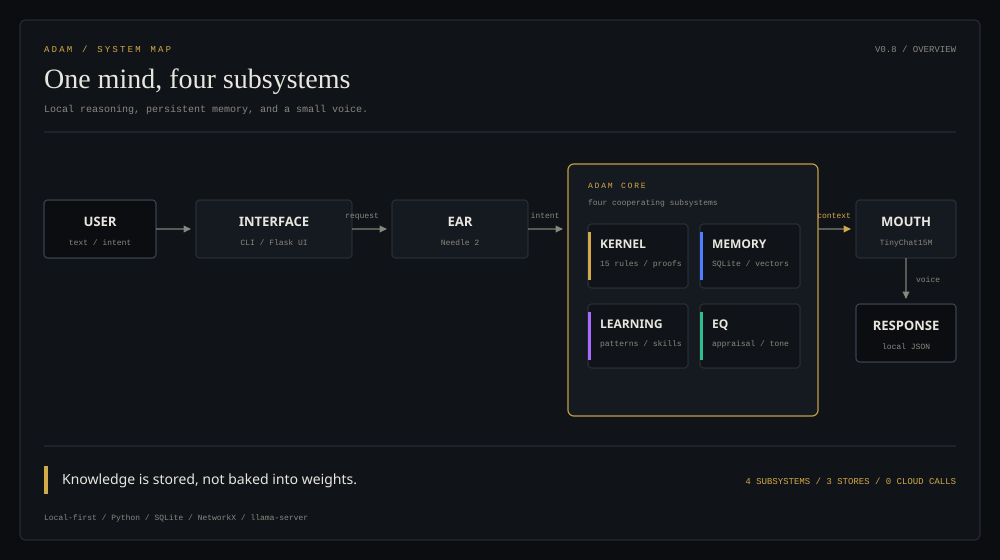
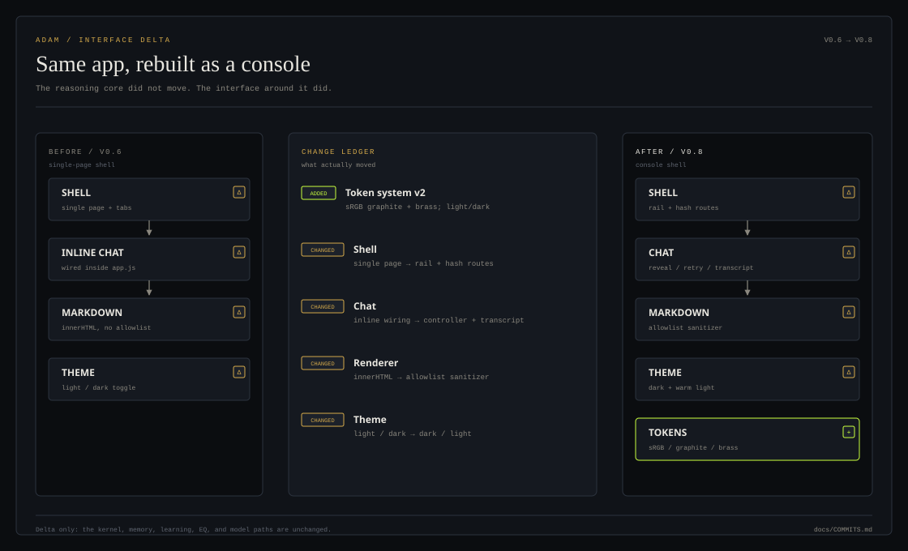
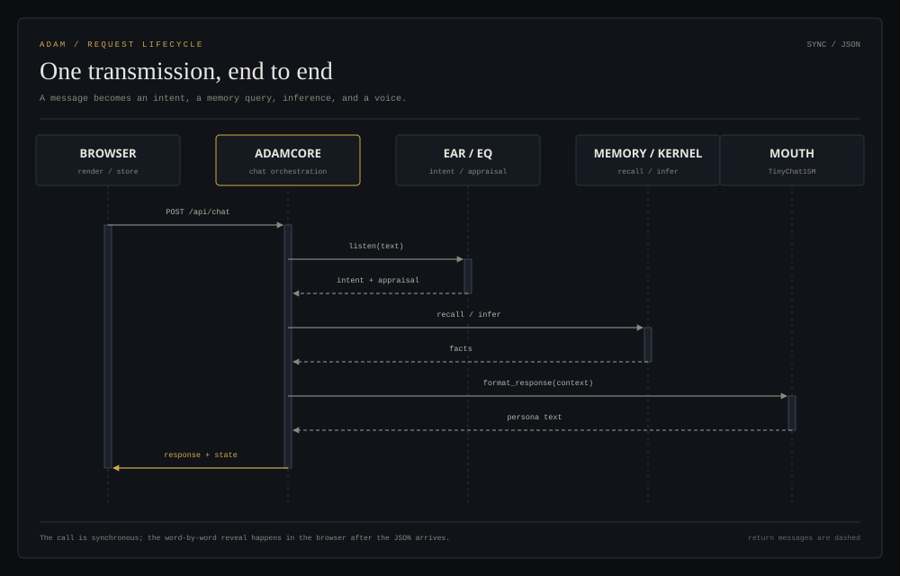
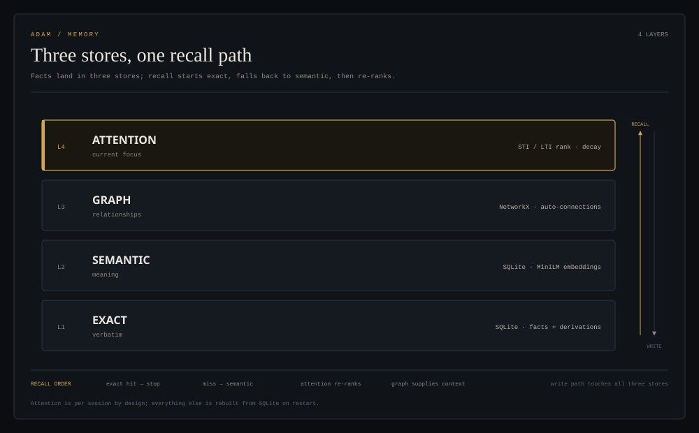
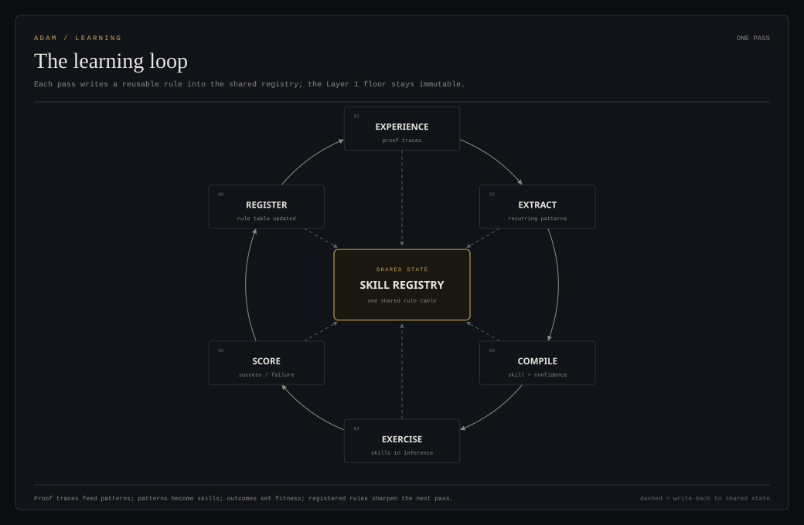
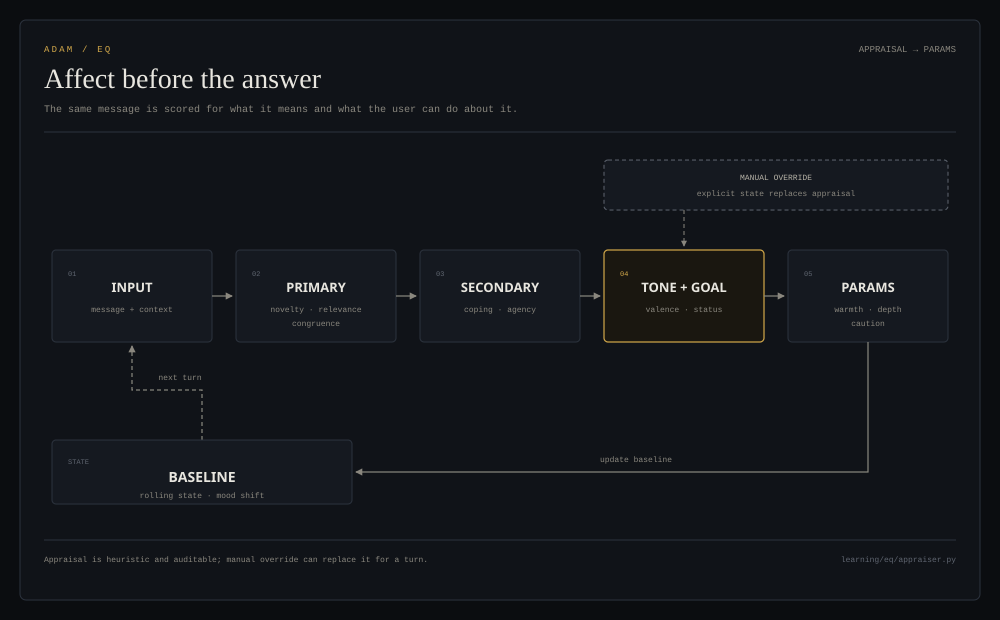
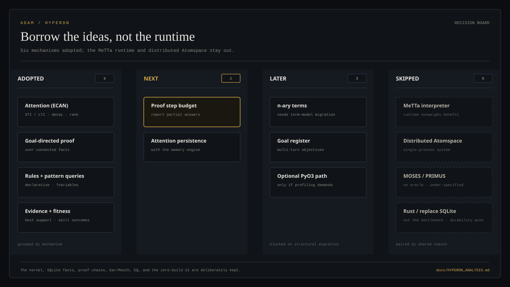

# ADAM

**A small, local reasoning system you can audit.**

[](https://opensource.org/licenses/MIT)
[](https://www.python.org/downloads/)
[](https://github.com/AdamMostofi/ADAM/actions/workflows/tests.yml)
[]()

ADAM is a local-first neuro-symbolic system. It has four parts:
- a symbolic kernel that reasons over subject–predicate–object facts;
- SQLite-backed memory that keeps those facts with the proofs behind them;
- a keyword-based reading of the user's tone;
- a 15M-parameter language model, used only to phrase small talk.

Runtime inference stays on the machine, and nothing calls a cloud service.

*Every conclusion ADAM draws can be walked back, step by step, to the facts
it was given and where they came from.*

This README describes what runs today. Each capability below points to the
test that shows it; anything without a test is listed under
[Planned](#planned).

---

## Quick start

```bash
git clone https://github.com/AdamMostofi/ADAM.git
cd ADAM
./install.sh
```

The installer installs the Python dependencies (with `uv` when available,
pinned by `uv.lock`), builds `llama-server`, and downloads and converts
TinyChat15M. The embedding model downloads on first use.

```bash
python -m interface.cli                 # interactive REPL
python -m interface.cli "hello"         # single-shot query
python -m interface.web.app             # web UI on http://localhost:7860
```

---

## Works today

| Capability | Where | Tested by |
|---|---|---|
| Fact store: one row per fact (deduplicated on write), schema migrations, provenance origins | `memory/exact_store.py` | `tests/integration/test_dedupe_and_meta.py`, `tests/integration/test_derivations.py` |
| 15 Layer 1 rules plus contradiction detection, each checked for soundness | `kernel/foundations.py`, [kernel-rules.md](docs/design/kernel-rules.md) | `tests/unit/test_rule_soundness.py`, `tests/unit/test_kernel_edge_cases.py` |
| Forward inference that gives the same beliefs whatever order facts arrive in | `kernel/engine.py` | `tests/integration/test_order_independence.py` |
| Goal-directed proof that agrees with forward inference | `kernel/prove.py` | `tests/integration/test_prove_agreement.py` |
| Membership (`instance_of`) separate from subclassing (`subclass_of`); ambiguous `is` kept for review, never guessed | `kernel/foundations.py` | `tests/unit/test_class_rules.py` |
| Every derived fact stored with its derivations, and walkable back to its inputs (`/api/facts/<id>/trace`) | `kernel/facts.py`, `memory/exact_store.py` | `tests/integration/test_derivations.py` |
| Contradictions recorded as state; defaults (`typically`) that yield to more specific evidence; per-source attribution | `kernel/conflicts.py`, `kernel/defaults.py` | `tests/integration/test_conflicts.py` |
| A restart rebuilds the engine and graph from SQLite and writes nothing | `memory/system.py`, [restart.md](docs/design/restart.md) | `tests/integration/test_restart.py` |
| Semantic recall: MiniLM-L6-v2 (int8 ONNX) embeddings in SQLite, searched with numpy | `memory/semantic_index.py`, [vector-index.md](docs/design/vector-index.md) | `tests/integration/test_vector_index.py` |
| Relationship graph (NetworkX) | `memory/connection_graph.py` | `tests/integration/test_graph.py` |
| Attention ranking of recalled facts (per session) | `memory/attention.py` | `tests/unit/test_attention.py` |
| Learned skills run as Layer 2 rules, with fitness tracking | `learning/skill_compiler.py` | `tests/unit/test_rules_registry.py`, `tests/unit/test_skill_fitness.py` |
| Ear (Cactus Needle, with a keyword fallback) and Mouth (TinyChat15M via `llama-server`) | `interface/ear.py`, `interface/mouth.py` | `tests/integration/test_ear_mouth.py` |
| EQ: keyword appraisal of tone, with word-boundary matching and negation | `learning/eq/`, [eq-appraisal.md](docs/design/eq-appraisal.md) | `tests/unit/test_eq_appraisal_matching.py`, `tests/integration/test_eq_comprehensive.py` |
| Web UI and JSON API (Flask, vanilla HTML/CSS/JS, no build step) | `interface/web/` | `tests/integration/test_interface.py` |
| CLI | `interface/cli.py` | `tests/integration/test_cli.py` |
| Memory budget: 400 MB while idle or chatting, measured | [memory-budget.md](docs/design/memory-budget.md) | `tests/unit/test_memory_probe.py` |
| Tests can't touch the real stores, and the stores can be backed up, audited and reset | `tests/store_guard.py`, `scripts/` | `tests/unit/test_store_guard.py`, `tests/integration/test_reset_store.py` |

CI runs the whole suite on Python 3.10 and 3.12.

### What it does not do yet

- **Chat runs forward inference, not proof.** `chat()` recalls facts, adds
  them to the engine and infers; it doesn't call `prove()`.
- **Factual answers aren't grounded in evidence yet.** The Mouth phrases the
  reply from recalled facts, and TinyChat15M can still make things up.
  Answering only from evidence is Stage 4.3.
- **The learning loop isn't connected to chat.** Pattern extraction and
  skill compilation work as a library and in tests; skills compiled earlier
  are loaded at startup. Learning from chat is Stage 5.7.
- **EQ reads explicit wording only.** It misses sarcasm, questions and
  litotes; its accuracy is recorded in
  [eq-appraisal.md](docs/design/eq-appraisal.md). A revisit is Stage 4.4.

---

## Planned

The single order of work is [docs/ROADMAP.md](docs/ROADMAP.md): 10 phases and
53 stages, done one at a time.

| Phase | Adds |
|---|---|
| 1 — Repair the Floor | The kernel and docs work listed above (Stages 1.1–1.8). |
| 2–3 — Memory engine | A standalone, lossless memory engine for coding agents ([design](docs/design/2026-11-06-agent-memory-engine.md)), then plugins for Claude Code, OpenCode, Pi and others. |
| 4 — The Citation Rite | Markdown sources with exact passages, answers only from evidence, the EQ revisit, citations in chat, and a thought trace. |
| 5 — The Book Study | Reading a real book into reviewed claims, measured against plain search, and a learning loop connected to chat. |
| 6 — The Ontology Web | A shared vocabulary, concept hierarchies across sources, and checked analogies. |
| 7 — The Tool Rites | Audited, approval-gated tools. |
| 8 — The Imperial Console | Reviewing sources, claims, traces and tool approvals in the console. |
| 9 — Portable Release | Licensing, a USB runtime, and agent clones (revalidated first). |

---

## Architecture



*The interface is thin; the core owns intent, memory, inference, learning, and
affect. The Mouth renders the answer.*

- **Ear** — Cactus Needle extracts action, topic, sentiment and urgency, with a
  keyword fallback when the model isn't available.
- **Kernel** — 15 Layer 1 rules plus contradiction detection
  ([kernel-rules.md](docs/design/kernel-rules.md)).
  - **Inference:** semi-naive and term-indexed, independent of fact order.
  - **Proof:** goal-directed, over the facts connected to the goal.
  - **Queries:** `?variable` patterns.
  - **Records:** structured derivations, and conflicts with defaults.
- **Memory** — SQLite for facts, derivations and origins; MiniLM embeddings in
  SQLite for semantic recall; NetworkX for relationships; attention for
  ranking.
- **Learning** — pattern extraction and skill compilation; compiled skills run
  as Layer 2 rules.
- **EQ** — keyword appraisal along appraisal-theory dimensions, producing a
  tone, a goal status and response parameters.
- **Mouth** — TinyChat15M served through `llama-server`.
- **Interface** — a `rich` CLI and a Flask web UI.

The Layer 1 rule floor is fixed in code, and learning only adds Layer 2 rules.

---

## The V0.8 interface



*The reasoning core did not move. The console around it did.*

The V0.8 pass replaced the single-page shell with a machined Imperial console:

- **Token system v2** — sRGB graphite, brass structure, neon state colors,
  jewel data colors, and a warm light/dark theme toggle.
- **Shell** — left rail for Vox, Cognition, Data-Vaults, Skills, and Rites; hash
  routing; topbar; toasts; collapsed rail; mobile dock.
- **Chat** — session transcript persistence, a `full` / `simple` mode selector,
  rotating thinking phases, retryable errors, and a capped, skippable reveal.
- **Markdown** — a strict allowlist sanitizer drops scripts, event handlers,
  embedded frames, styles, and unsafe URL schemes.
- **No build step** — no Node runtime, no bundler, no framework upgrade path to
  maintain. The UI is served directly by Flask.

The Vox, Data-Vaults, and Rites names are interface labels, not separate services.

---

## One transmission



*A browser message becomes an intent, a memory query, inference, and a voice.*

`POST /api/chat` is synchronous. The core:
1. calls the Ear;
2. appraises the message;
3. recalls facts;
4. runs forward inference, storing any new conclusions with their
   derivations;
5. formats the response.

The browser receives JSON and handles the word-by-word reveal locally.

```bash
curl -s http://localhost:7860/api/chat \
  -H 'Content-Type: application/json' \
  -d '{"message":"hello","mode":"full"}'
```

---

## Memory



*A fact is written to all three stores; recall starts exact, falls back to
semantic, then re-ranks by attention.*

- **Exact** — SQLite (schema 3) stores:
  - every fact verbatim;
  - every derivation, meaning the rule, its version, the premises and the
    confidence;
  - where each fact came from.

  A derived fact can't be stored without its derivation.
- **Semantic** — MiniLM-L6-v2 embeddings, int8 ONNX run directly with
  onnxruntime, stored in one SQLite file and searched with numpy. They are
  used when exact text search finds nothing.
- **Graph** — NetworkX keeps nodes and relationships and supplies related
  context for the data-vault views.
- **Attention** — STI/LTI ranking decays and re-ranks recalled facts.

Attention is per session by design: it is the focus of the current
conversation. Everything else comes back on restart: facts, proofs,
conflicts, sources and the graph are rebuilt from SQLite
([restart.md](docs/design/restart.md)).

---

## Learning



*The loop as designed. Today the library and Layer 2 skills work; connecting
it to chat is Stage 5.7.*

1. Extract recurring patterns from derivation records, with their real
   premises.
2. Compile a skill with premises, conclusion, confidence, and domain.
3. Run the skill in inference as a Layer 2 rule.
4. Score the outcome and update fitness.

The Layer 1 rules remain the trust floor. Nothing learned can rewrite them.

---

## EQ



*Affect is computed before the answer is written.*

The EQ subsystem borrows its dimensions from Scherer's Component Process Model
and Lazarus/Folkman appraisal. The mechanism itself is keyword counting: small
word-and-phrase lexicons, matched on word boundaries with simple negation. It
reads explicit wording, not sarcasm or context. On a 24-sentence held-out probe
set it gets 83% of tones right ([eq-appraisal.md](docs/design/eq-appraisal.md)).

- **Primary appraisal** — novelty, goal relevance, goal congruence.
- **Secondary appraisal** — coping potential and agency.
- **Output** — emotional tone, goal status, engagement, and confidence.
- **Adjustment** — warmth, directness, depth, and caution flags.
- **Baseline** — rolling interaction state and mood-shift detection.

Manual override can replace the appraisal for a turn.

---

## What we took from Hyperon



*Borrow the ideas, not the runtime.*

Adopted from the OpenCog Hyperon analysis:

- **ECAN-style attention.**
- **Goal-directed proof.**
- **Declarative rules plus `?variable` pattern queries.**
- **Fitness-weighted skills.**
- **A stats surface** for facts, contradictions, and proof traces.
- **Evidence tracking.** Each belief counts its distinct derivations, and its
  confidence is its best support. That replaced the planned PLN revision,
  which double-counted shared premises ([kernel-rules.md](docs/design/kernel-rules.md)).

n-ary terms, a goal register, and an optional PyO3 path are later. The MeTTa
interpreter, distributed Atomspace, MOSES evolution, PRIMUS, a Rust rewrite, and
replacing SQLite are deliberately skipped. The full reasoning is in
[docs/HYPERON_ANALYSIS.md](docs/HYPERON_ANALYSIS.md).

---

## Related work

ADAM is not the first system to read sources into a symbolic knowledge base:

- the Learning Reader;
- NELL, the Never-Ending Language Learner;
- OpenCog Hyperon.

What it aims to show is narrower and checkable: a system small enough to run
locally within 400 MB, where every conclusion has a proof back to its sources.

---

## Technology stack

| Component | Technology |
|-----------|-----------|
| Language | Python 3.10+, dependencies pinned in `uv.lock` |
| Inference | Semi-naive, term-indexed forward chaining; goal-directed proof |
| Exact storage | SQLite |
| Vector store | Embeddings as blobs in SQLite, searched with numpy |
| Embeddings | `all-MiniLM-L6-v2` int8 ONNX (`Xenova/all-MiniLM-L6-v2`, pinned revision) via onnxruntime |
| Graph | NetworkX `MultiDiGraph` |
| Ear | Cactus Needle (`cactus-needle==3.2.1`) |
| Mouth | TinyChat15M (GGUF, about 98 MB) via `llama-server` |
| CLI | `rich` |
| Web UI | Flask + vanilla HTML/CSS/JS |
| Graph view | vendored `vis-network` |
| Models | dataclasses, Pydantic |
| Testing | pytest, hypothesis; CI on GitHub Actions |

---

## Project structure

```text
ADAM/
├── kernel/                 # rules, inference, proof, conflicts
│   ├── engine.py           # InferenceEngine
│   ├── foundations.py      # Layer 1 rules
│   ├── rules.py            # rule registry
│   ├── prove.py            # goal-directed proof
│   ├── conflicts.py        # contradictions as state
│   ├── defaults.py         # defaults with exceptions
│   └── facts.py            # Fact, Belief, Derivation
├── memory/                 # exact, semantic, graph, attention
│   ├── system.py           # MemorySystem facade and restore
│   ├── exact_store.py      # SQLite facts, derivations, origins
│   ├── semantic_index.py   # MiniLM embeddings in SQLite
│   ├── connection_graph.py # NetworkX
│   └── attention.py        # STI/LTI ranking
├── learning/               # patterns, skills, analogy, correction
│   ├── engine.py           # LearningEngine
│   ├── pattern_extractor.py
│   ├── skill_compiler.py
│   └── eq/                 # appraisal, lexicon, adjustment, baseline
├── interface/              # CLI, Ear, Mouth, Flask
│   ├── core.py             # ADAMCore facade
│   ├── ear.py
│   ├── mouth.py
│   └── web/
├── scripts/                # backup, audit, reset, measurements
├── docs/
│   ├── ROADMAP.md          # the order of work
│   ├── DECISIONS.md        # every decision and where it lives
│   ├── design/
│   ├── measurements/
│   └── diagrams/
├── tests/
├── install.sh
├── pyproject.toml, uv.lock
└── LICENSE
```

---

## Tests

```bash
uv run pytest -q                    # everything
uv run pytest -m "not slow" -q      # what CI runs first
```

---

## Docs

- [Roadmap](docs/ROADMAP.md) — the single order of work.
- [Decisions](docs/DECISIONS.md) — every recorded decision, its outcome, and
  where it lives.
- [Kernel rules](docs/design/kernel-rules.md) — every rule, proofs, conflicts,
  the engine, and measurements.
- [Restart](docs/design/restart.md), [vector index](docs/design/vector-index.md),
  [memory budget](docs/design/memory-budget.md),
  [EQ appraisal](docs/design/eq-appraisal.md).
- [Memory engine design](docs/design/2026-11-06-agent-memory-engine.md)
  (Phases 2–3).
- [OpenCog Hyperon analysis](docs/HYPERON_ANALYSIS.md),
  [thread safety](docs/design/thread-safety.md),
  [USB deployment](docs/design/usb-deployment.md),
  [agent clones](docs/design/agent-clones.md).
- [Changelog](CHANGELOG.md); [early commit history](docs/COMMITS.md) (to V0.7).

Every document in `docs/` starts with a status line: current, proposed,
superseded, or historical.

---

## Credits

Diagrams follow the editorial grammar of
[Diagram Design](https://github.com/cathrynlavery/diagram-design) by Cathryn
Lavery (MIT), re-skinned to ADAM's interface tokens.

The chat surface was informed by Vercel's AI Elements and rebuilt as a
self-contained vanilla JavaScript port.

---

## License

[MIT](LICENSE)
