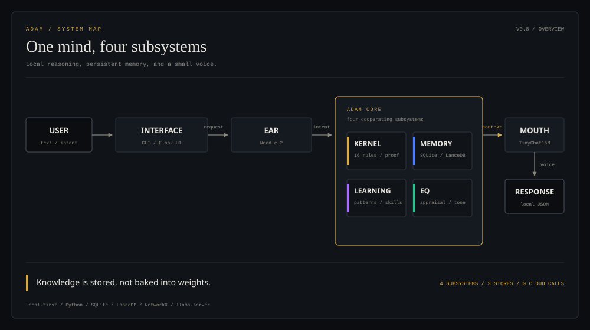
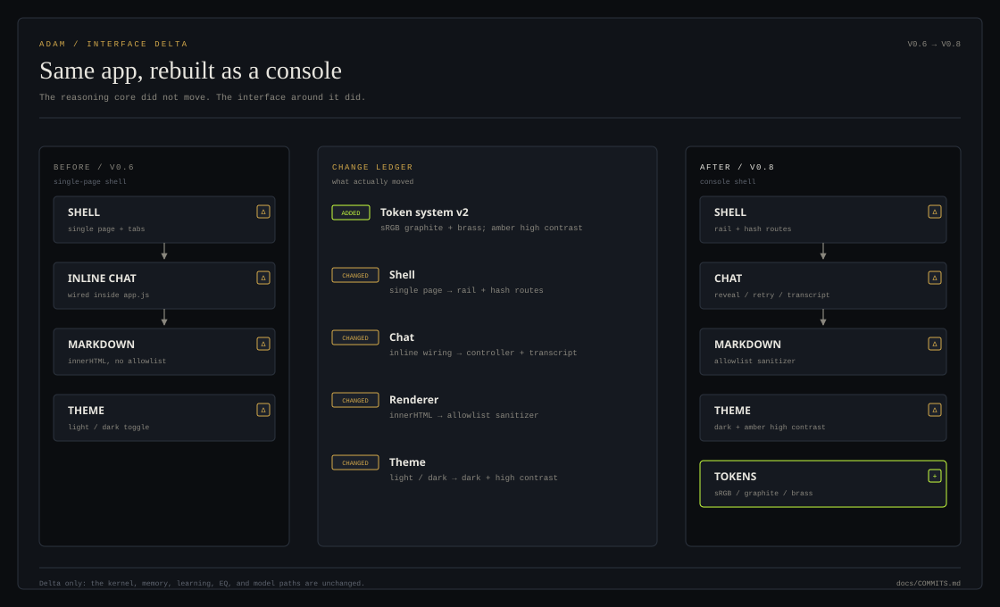
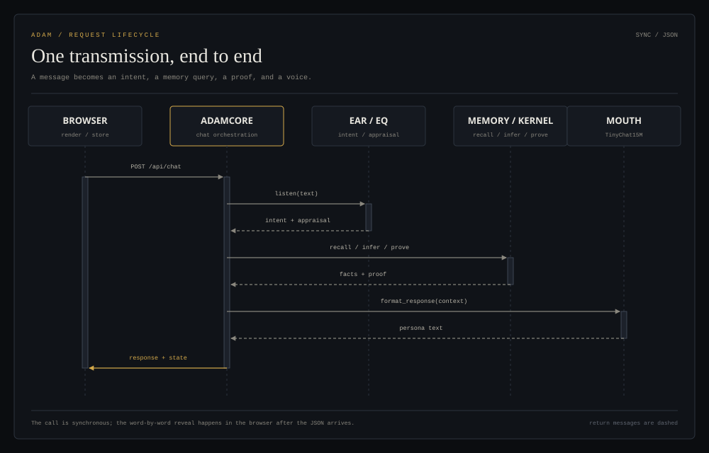
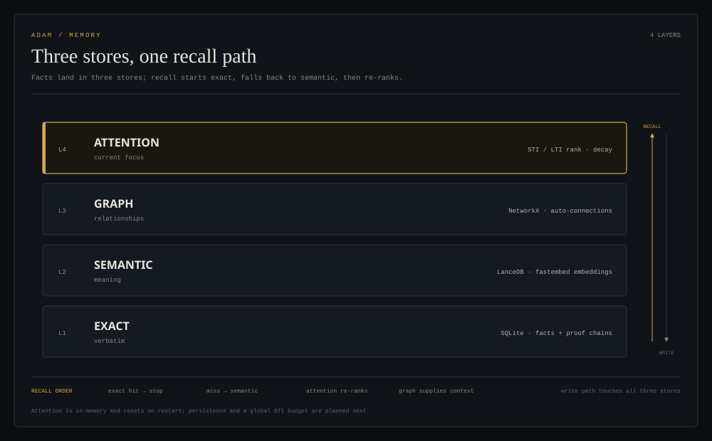
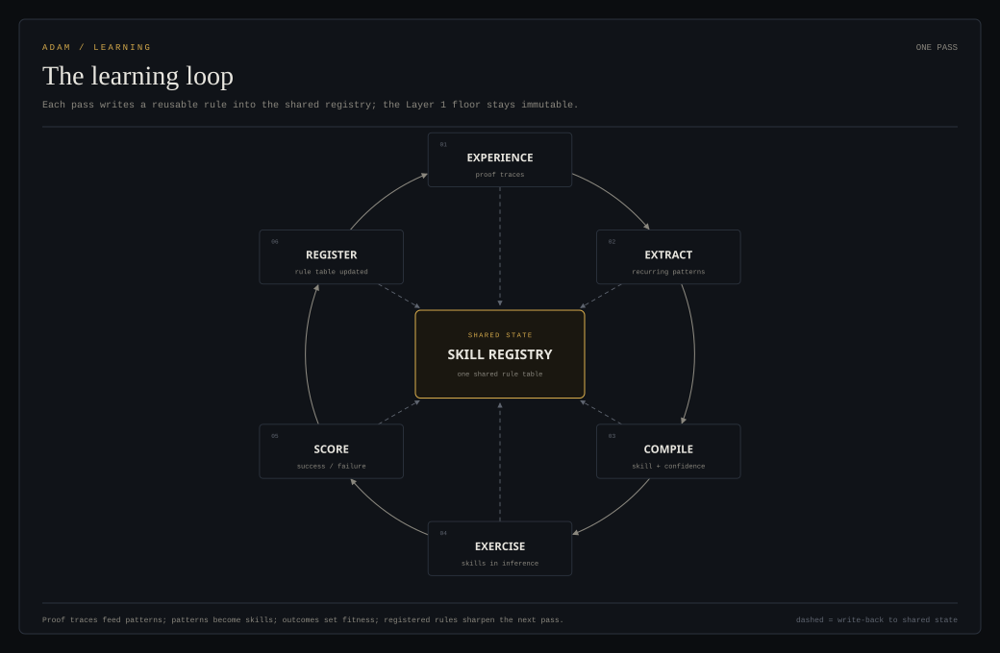
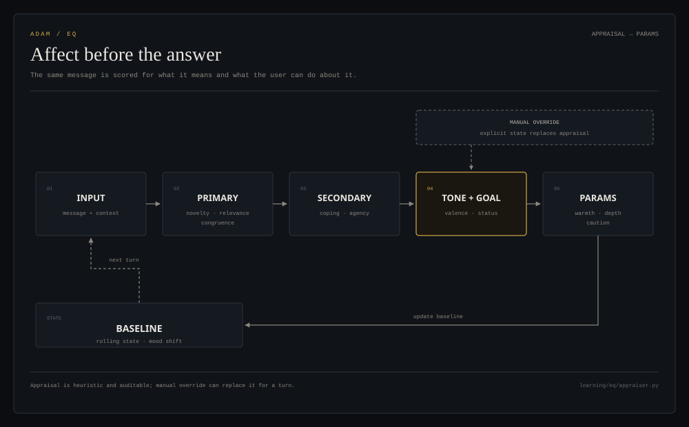
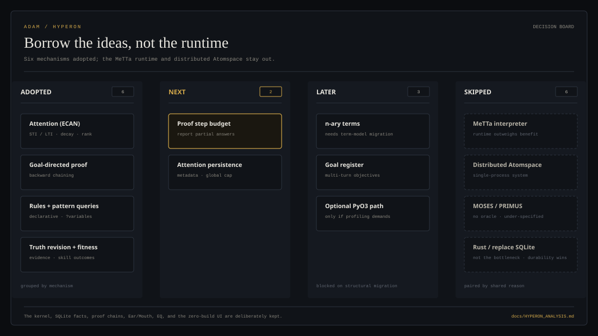
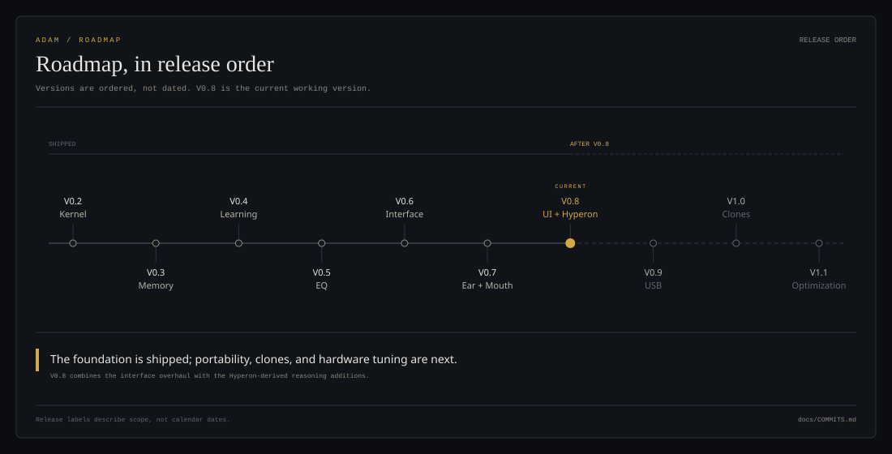

# ADAM

**A local neuro-symbolic machine intelligence.**

[](https://opensource.org/licenses/MIT)
[](https://www.python.org/downloads/)
[]()
[]()

ADAM is a local-first cognitive architecture: a small symbolic kernel for
reasoning, three stores for persistent memory, a learning loop that compiles
skills into rules, and a lightweight language model for the voice. Runtime
inference stays on the machine.

*First of its kind: a small, local mind that remembers.*

---

## Quick Start

### One-command install

```bash
git clone https://github.com/AdamMostofi/ADAM.git
cd ADAM
./install.sh
```

The installer builds `llama-server`, downloads and converts TinyChat15M, and
installs the Python dependencies.

### Manual start

```bash
# CLI
python -m interface.cli                 # interactive REPL
python -m interface.cli "hello"         # single-shot query
python -m interface.cli --web           # launch the web UI

# Web UI
python -m interface.web.app             # http://localhost:7860
```

---

## Architecture



*The interface is thin; the core owns intent, memory, inference, learning, and
affect. The Mouth renders the answer.*

- **Ear** — Needle 2 extracts action, topic, sentiment, and urgency.
- **Kernel** — 16 immutable Layer 1 rules, predicate-indexed forward inference,
  goal-directed proof, `?variable` pattern queries, and staged truth revision.
- **Memory** — SQLite for verbatim facts and proofs, LanceDB for semantic
  recall, NetworkX for relationships, and ECAN-style attention for ranking.
- **Learning** — proof patterns become skills, skills become Layer 2 rules, and
  outcomes update fitness.
- **EQ** — cognitive appraisal produces a tone, goal status, and response
  parameters, then folds the turn into a rolling baseline.
- **Mouth** — TinyChat15M served through `llama-server`.
- **Interface** — a `rich` CLI and a Flask web UI built with vanilla HTML, CSS,
  and JavaScript.

The Layer 1 rule floor stays immutable. Learning is additive.

---

## The V0.8 interface



*The reasoning core did not move. The console around it did.*

The V0.8 pass replaced the single-page shell with a machined Imperial console:

- **Token system v2** — sRGB graphite, brass structure, neon state colors,
  jewel data colors, and an amber high-contrast mode.
- **Shell** — left rail for Vox, Cognition, Data-Vaults, Skills, and Rites; hash
  routing; topbar; toasts; collapsed rail; mobile dock.
- **Chat** — session transcript persistence, a `full` / `simple` mode selector,
  rotating thinking phases, retryable errors, and a capped, skippable reveal.
- **Markdown** — a strict allowlist sanitizer drops scripts, event handlers,
  embedded frames, styles, and unsafe URL schemes.
- **No build step** — no Node runtime, no bundler, no framework upgrade path to
  maintain. The UI is served directly by Flask.

The Vox, Data-Vaults, and Rites names are interface labels, not separate services.

---

## One transmission



*A browser message becomes an intent, a memory query, a proof, and a voice.*

`POST /api/chat` is synchronous. The core calls the Ear, appraises the message,
recalls facts, runs inference or proof, and formats the response. The browser
receives JSON and handles the word-by-word reveal locally.

```bash
curl -s http://localhost:7860/api/chat \
  -H 'Content-Type: application/json' \
  -d '{"message":"hello","mode":"full"}'
```

---

## Memory



*A fact is written to all three stores; recall starts exact, falls back to
semantic, then re-ranks by attention.*

- **Exact** — SQLite stores every fact verbatim, with proof chains and indexes
  on subject, predicate, object, source, and confidence.
- **Semantic** — LanceDB plus `fastembed` (ONNX) provides the semantic fallback
  when exact text search returns nothing.
- **Graph** — NetworkX keeps nodes and relationships, and supplies related
  context for the data-vault views.
- **Attention** — STI/LTI ranking decays and re-ranks recalled facts.

Attention is currently in-memory and resets on restart. Persistence and a global
STI budget are the next memory work.

---

## Learning



*Proofs leave a trail; the trail becomes a pattern; the pattern becomes a rule.*

ADAM learns from its own proof traces:

1. Extract recurring patterns from proof chains.
2. Compile a skill with premises, conclusion, confidence, and domain.
3. Exercise the skill in inference.
4. Score the outcome and update fitness.
5. Register the skill as a Layer 2 rule.

The immutable Layer 1 rules remain the trust floor. Nothing learned can rewrite
them.

---

## EQ



*Affect is computed before the answer is written.*

The EQ subsystem is inspired by Scherer's Component Process Model and
Lazarus/Folkman appraisal:

- **Primary appraisal** — novelty, goal relevance, goal congruence.
- **Secondary appraisal** — coping potential and agency.
- **Output** — emotional tone, goal status, engagement, and confidence.
- **Adjustment** — warmth, directness, depth, and caution flags.
- **Baseline** — rolling interaction state and mood-shift detection.

Manual override can replace the appraisal for a turn.

---

## What we took from Hyperon



*Borrow the ideas, not the runtime.*

Six mechanisms were adopted from the OpenCog Hyperon analysis:

- ECAN-style attention.
- Goal-directed backward chaining.
- Declarative rules plus `?variable` pattern queries.
- Staged truth revision.
- Fitness-weighted skills.
- A stats surface for facts, contradictions, and proof traces.

n-ary terms, a goal register, and an optional PyO3 path are later. The MeTTa
interpreter, distributed Atomspace, MOSES evolution, PRIMUS, a Rust rewrite, and
replacing SQLite are deliberately skipped. The full reasoning is in
[docs/HYPERON_ANALYSIS.md](docs/HYPERON_ANALYSIS.md).

---

## Roadmap



*Release order, not calendar time.*

- **Shipped** — V0.2 kernel, V0.3 memory, V0.4 learning, V0.5 EQ, V0.6
  interface, V0.7 Ear/Mouth.
- **Current** — V0.8: interface overhaul plus the Hyperon-derived reasoning
  additions.
- **Next** — V0.9 portable USB runtime, V1.0 specialized agent clones with
  bidirectional knowledge transfer, V1.1 profiling and hardware tuning.

---

## Technology Stack

| Component | Technology |
|-----------|-----------|
| Language | Python 3.10+ |
| Inference | Custom predicate-indexed agenda, forward chaining, goal-directed proof |
| Exact storage | SQLite |
| Vector store | LanceDB |
| Embeddings | fastembed (ONNX), `BAAI/bge-small-en-v1.5` |
| Graph | NetworkX `MultiDiGraph` |
| Ear | Cactus Needle 2 |
| Mouth | TinyChat15M via `llama-server` |
| CLI | `rich` |
| Web UI | Flask + vanilla HTML/CSS/JS |
| Graph view | vendored `vis-network` |
| Models | dataclasses, Pydantic |
| Testing | pytest, hypothesis |

---

## Project Structure

```text
ADAM/
├── kernel/                 # rules, inference, proof, truth revision
│   ├── engine.py           # InferenceEngine
│   ├── foundations.py      # immutable Layer 1 rules
│   ├── prove.py            # goal-directed backward chaining
│   ├── rules.py            # declarative rule registry
│   └── truth.py            # PLN-style revision
├── memory/                 # exact, semantic, graph, attention
│   ├── system.py           # MemorySystem facade
│   ├── exact_store.py      # SQLite
│   ├── semantic_index.py   # LanceDB + fastembed
│   ├── connection_graph.py # NetworkX
│   └── attention.py        # STI/LTI ranking
├── learning/               # patterns, skills, analogy, correction
│   ├── engine.py           # LearningEngine
│   ├── pattern_extractor.py
│   ├── skill_compiler.py
│   └── eq/                 # appraisal, adjustment, baseline
├── interface/              # CLI, Ear, Mouth, Flask
│   ├── core.py             # ADAMCore facade
│   ├── ear.py
│   ├── mouth.py
│   └── web/
├── docs/
│   ├── COMMITS.md
│   ├── HYPERON_ANALYSIS.md
│   ├── design/
│   └── diagrams/           # 8 README diagrams (SVG)
├── tests/
├── install.sh
├── requirements.txt
└── LICENSE
```

---

## Tests

```bash
python -m pytest tests/ -q
python -m pytest tests/integration/test_interface.py -q
```

The interface suite currently covers 22 tests.

---

## Docs

- [Commit history and design decisions](docs/COMMITS.md)
- [OpenCog Hyperon analysis](docs/HYPERON_ANALYSIS.md)
- [Thread safety](docs/design/thread-safety.md)
- [USB deployment](docs/design/usb-deployment.md)
- [Agent clones](docs/design/agent-clones.md)
- [Future enhancements](docs/design/future-enhancements.md)

---

## Credits

Diagrams follow the editorial grammar of
[Diagram Design](https://github.com/cathrynlavery/diagram-design) by Cathryn
Lavery (MIT), re-skinned to ADAM's interface tokens.

The chat surface was informed by Vercel's AI Elements and rebuilt as a
self-contained vanilla JavaScript port.

---

## License

[MIT](LICENSE)
