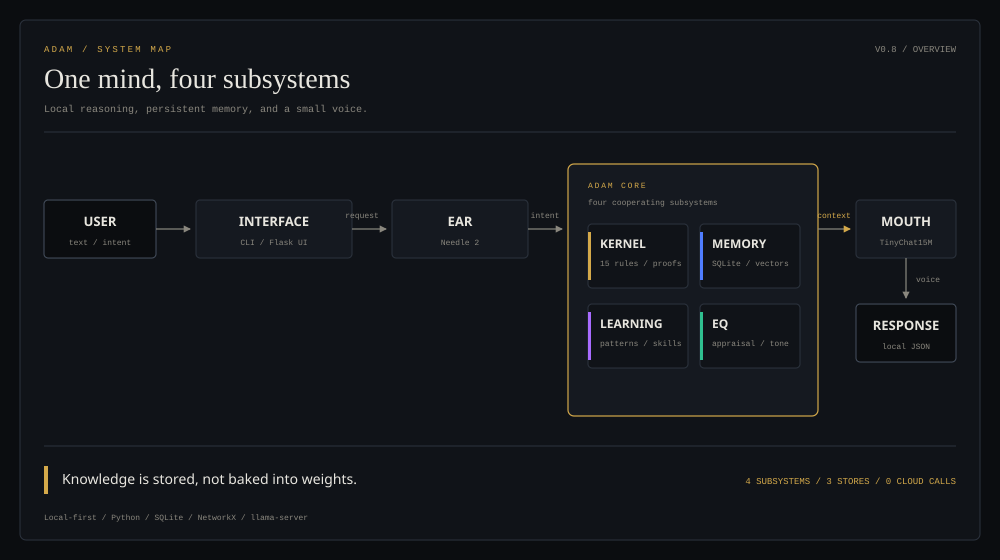
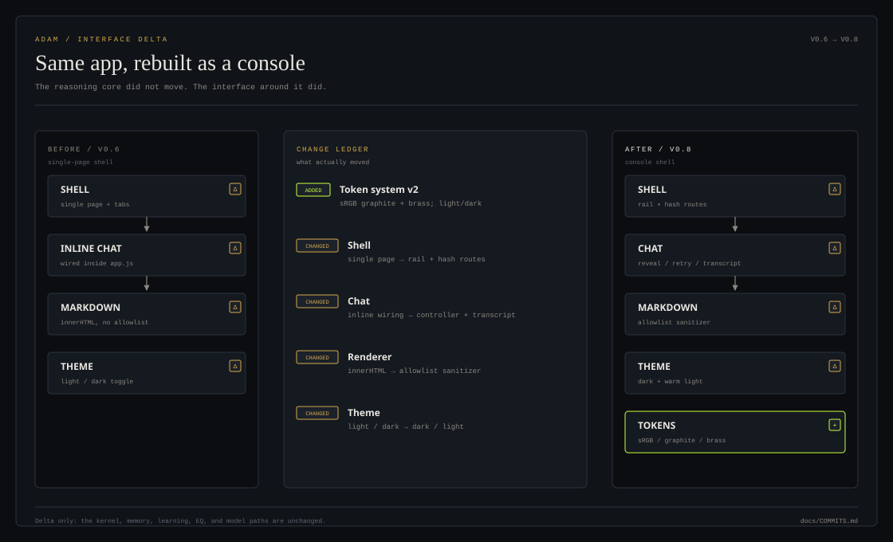
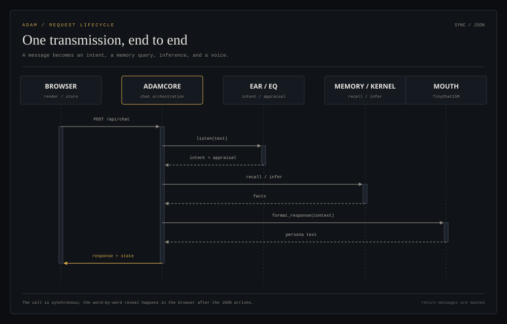
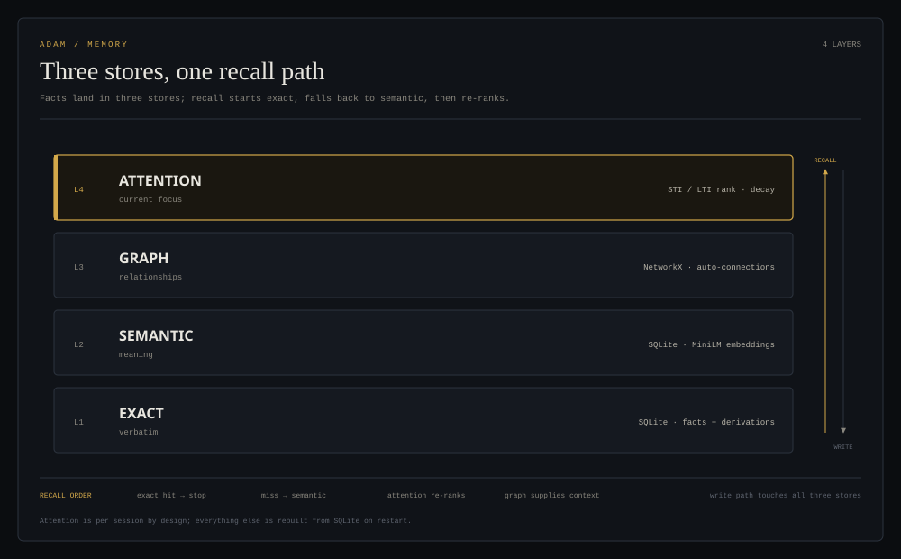
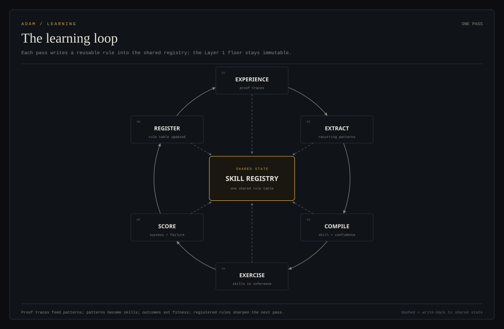
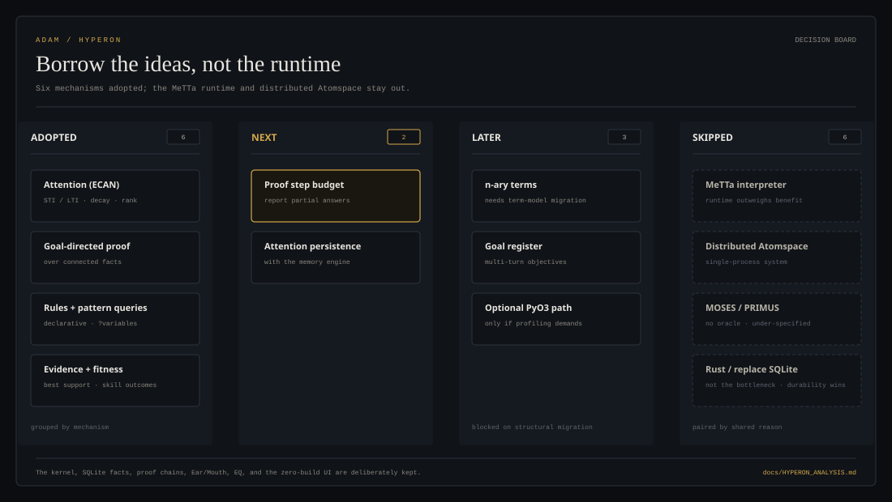

# ADAM

**A small, local reasoning system you can audit.**

[](https://opensource.org/licenses/MIT)
[](https://www.python.org/downloads/)
[](https://github.com/AdamMostofi/ADAM/actions/workflows/tests.yml)
[]()

ADAM is a local-first neuro-symbolic system. It has four parts:
- a symbolic kernel that reasons over subject–predicate–object facts;
- memory, on the [Yewtree](https://github.com/AdamMostofi/yewtree) engine, that keeps those facts with the
  proofs behind them;
- a keyword-based reading of the user's tone;
- a 15M-parameter language model, used only to phrase small talk.

Runtime inference stays on the machine, and nothing calls a cloud service.

*Every conclusion ADAM draws can be walked back, step by step, to the facts
it was given and where they came from.*

The repository also holds a second, standalone product: the
**[memory engine](#memory-engine)** (`packages/agent-memory/`). It is a lossless,
tree-structured memory for long-running AI agents, with coding as the main
use case. It is being built in Phase 2, never imports ADAM, and will become
ADAM's memory in Phase 4.

This README describes what runs today. Each capability below points to the
test that shows it; anything without a test is listed under
[Planned](#planned).

---

## Quick start

```bash
git clone https://github.com/AdamMostofi/ADAM.git
cd ADAM
./install.sh
```

The installer installs the Python dependencies (with `uv` when available,
pinned by `uv.lock`), builds `llama-server`, and downloads and converts
TinyChat15M. The embedding model downloads on first use.

```bash
python -m interface.cli                 # interactive REPL
python -m interface.cli "hello"         # single-shot query
python -m interface.web.app             # web UI on http://localhost:7860
```

---

## Works today

| Capability | Where | Tested by |
|---|---|---|
| One storage contract, two stores: the [Yewtree](https://github.com/AdamMostofi/yewtree) engine (default) and the original SQLite store (`ADAM_STORE=exact`), held to the same tests | `memory/store_contract.py`, `memory/engine_store.py`, [storage-contract.md](docs/design/storage-contract.md) | `tests/contract/test_store_contract.py` |
| Only `memory/engine_store.py` imports the engine; the kernel imports neither it nor the memory layer; core and routes never reach into a store | `memory/` | `tests/contract/test_storage_boundary.py` |
| Source library (Data-Vault): Markdown ingested once from the command line, cut into paragraphs with exact character offsets and SHA-256, searched with SQLite FTS5 (BM25); no model | `memory/source_library.py`, [source-library.md](docs/design/source-library.md) | `tests/integration/test_source_library.py` |
| Fact store: one fact per triple and source (deduplicated on write), provenance origins | `memory/engine_store.py`, `memory/exact_store.py` | `tests/contract/test_store_contract.py`, `tests/integration/test_dedupe_and_meta.py` |
| 15 Layer 1 rules plus contradiction detection, each checked for soundness | `kernel/foundations.py`, [kernel-rules.md](docs/design/kernel-rules.md) | `tests/unit/test_rule_soundness.py`, `tests/unit/test_kernel_edge_cases.py` |
| Forward inference that gives the same beliefs whatever order facts arrive in | `kernel/engine.py` | `tests/integration/test_order_independence.py` |
| Goal-directed proof that agrees with forward inference | `kernel/prove.py` | `tests/integration/test_prove_agreement.py` |
| Membership (`instance_of`) separate from subclassing (`subclass_of`); ambiguous `is` kept for review, never guessed | `kernel/foundations.py` | `tests/unit/test_class_rules.py` |
| Every derived fact stored with its derivations, and walkable back to its inputs (`/api/facts/<id>/trace`); in the engine store, a derivation is a record linked to its premises and conclusion | `kernel/facts.py`, `memory/store_contract.py` | `tests/integration/test_derivations.py`, `tests/contract/test_store_contract.py` |
| Contradictions recorded as state; defaults (`typically`) that yield to more specific evidence; per-source attribution | `kernel/conflicts.py`, `kernel/defaults.py` | `tests/integration/test_conflicts.py` |
| A restart rebuilds the engine and graph from the store and writes nothing | `memory/system.py`, [restart.md](docs/design/restart.md) | `tests/integration/test_restart.py` |
| Semantic recall: MiniLM-L6-v2 (int8 ONNX) embeddings in SQLite, searched with numpy | `memory/semantic_index.py`, [vector-index.md](docs/design/vector-index.md) | `tests/integration/test_vector_index.py` |
| Relationship graph (NetworkX) | `memory/connection_graph.py` | `tests/integration/test_graph.py` |
| Attention ranking of recalled facts (per session) | `memory/attention.py` | `tests/unit/test_attention.py` |
| Learned skills run as Layer 2 rules, with fitness tracking | `learning/skill_compiler.py` | `tests/unit/test_rules_registry.py`, `tests/unit/test_skill_fitness.py` |
| Answers only from evidence: facts worded from proofs, passages quoted with citations, no answer without evidence; the Mouth's text shown only when it asserts nothing | `interface/evidence.py`, [evidence-answers.md](docs/design/evidence-answers.md) | `tests/integration/test_evidence_answers.py` |
| Exact citations in the web chat: `citations` in `/api/chat`, and a Data-Vault sources block (source, paragraph, character range, hash, snippet) rendered as text | `interface/core.py`, `interface/web/static/js/chat.js` | `tests/integration/test_citations.py` |
| A thought trace for every chat turn: typed nodes (PERCEIVE, RECALL, INFER, ANSWER) linked to the proof records and citations, English rendered on request, `/api/traces/<id>`, and a "How this answer was reached" panel; every trace kept, conversations beyond the last 5,000 compressed | `memory/trace_log.py`, [thought-trace.md](docs/design/thought-trace.md) | `tests/integration/test_thought_trace.py` |
| Ear (Cactus Needle, with a keyword fallback) and Mouth (TinyChat15M via `llama-server`) | `interface/ear.py`, `interface/mouth.py` | `tests/integration/test_ear_mouth.py` |
| EQ, reduced to one signal: is the user frustrated? Word matching with negation, yes/no questions, litotes, an obvious sarcasm cue and context; it softens ADAM's own wording only | `learning/eq/`, [eq-appraisal.md](docs/design/eq-appraisal.md) | `tests/unit/test_eq_appraisal_matching.py` |
| Web UI and JSON API (Flask, vanilla HTML/CSS/JS, no build step) | `interface/web/` | `tests/integration/test_interface.py` |
| CLI | `interface/cli.py` | `tests/integration/test_cli.py` |
| Memory budget: 400 MB while idle or chatting, measured | [memory-budget.md](docs/design/memory-budget.md) | `tests/unit/test_memory_probe.py` |
| Tests can't touch the real stores, and the stores can be backed up, audited and reset | `tests/store_guard.py`, `scripts/` | `tests/unit/test_store_guard.py`, `tests/integration/test_reset_store.py` |

CI runs the whole suite on Python 3.10 and 3.12, plus the memory engine's own
suite in an environment without ADAM.

### What it does not do yet

- **ADAM understands a few question shapes.** It answers "is X Y?",
  "what/who is X?", "tell me about X" and statements like "X is Y" from
  proofs, and other questions only from passages that hold most of their
  words. Anything else gets "I won't guess" rather than an answer
  ([evidence-answers.md](docs/design/evidence-answers.md)).
- **The Mouth rarely speaks.** Its text is shown only when it asserts
  nothing (a conversational reply to chatter). TinyChat15M can't restate
  facts, so factual sentences are worded from the proof instead.
- **The learning loop isn't connected to chat.** Pattern extraction and
  skill compilation work as a library and in tests; skills compiled earlier
  are loaded at startup. Learning from chat is Stage 5.7.
- **EQ reads a few words.** Its frustration signal knows only the Stage 1.7
  lexicon, so "this is a disaster" or "that's useless" go unnoticed, and
  sarcasm beyond an opening "great, …" is out of reach. Its scores are in
  [eq-appraisal.md](docs/design/eq-appraisal.md).
- **The engine store is slower to write.** Since Stage 4.1, ADAM keeps
  its facts in the memory engine. Writing a fact there takes about two and
  a half times as long as in the original SQLite store, and the store is about six
  times larger on disk; reads are faster. The figures are in
  [storage-contract.md](docs/design/storage-contract.md).
- **The source library is command-line only, Markdown only, and not used
  in answers yet.** Sources are ingested and searched from the command
  line ([source-library.md](docs/design/source-library.md)); answering
  only from passages is Stage 4.3. Its search index keeps passage text
  unencrypted on disk. Skills and traces have a place in the store but no
  users yet; learned skills are still files in `skills/`.

---

## Memory engine

The memory engine (command `amem`) was built here in Phases 2 and 3, under the working name `agent-memory`. It is
now its own project, with its history: **[Yewtree](https://github.com/AdamMostofi/yewtree)**, lossless,
tree-structured memory for coding agents.

**ADAM depends on a pinned release:** `yewtree` v0.3.0 in `pyproject.toml`, installed from its tagged GitHub
release. This repository holds no copy of it.

**The principle:** the entire history is kept permanently, but an agent loads only what it needs, from the
right tree, at the right time.

**Where things are now:**
- **Capabilities, tests and install instructions:** in its [README](https://github.com/AdamMostofi/yewtree#readme).
- **What each coding agent gets:** in [docs/agents.md](https://github.com/AdamMostofi/yewtree/blob/main/docs/agents.md).
- **Security notes:** in [SECURITY.md](https://github.com/AdamMostofi/yewtree/blob/main/SECURITY.md).

Design documents (they stay here, as the record of how it was designed):
- [architecture revision 3](docs/design/2026-11-13-memory-architecture-rev3.md), the current architecture;
- the [original design](docs/design/2026-11-06-agent-memory-engine.md).

| Capability | Where | Tested by |
|---|---|---|
| ADAM uses the released engine: the pinned version installs, imports, and stores and verifies a record | `pyproject.toml` | `tests/unit/test_memory_engine_release.py` |

## Planned

The single order of work is [docs/ROADMAP.md](docs/ROADMAP.md): 10 phases and
57 stages, done one at a time.

| Phase | Adds |
|---|---|
| 1 — Repair the Floor | The kernel and docs work listed above (Stages 1.1–1.8). |
| 2 — Forge the Memory Engine | The [memory engine](#memory-engine). Complete (Stages 2.1–2.11). |
| 3 — Carry the Memory | Plugins for Claude Code (3.1, built), OpenCode, Pi and others; a benchmark that decides whether to continue; a standalone release. |
| 4 — The Citation Rite | ADAM's storage moved onto the memory engine, Markdown sources with exact passages, answers only from evidence, the EQ revisit, citations in chat, and a thought trace. |
| 5 — The Book Study | Reading a real book into reviewed claims, measured against plain search, and a learning loop connected to chat. |
| 6 — The Ontology Web | A shared vocabulary, concept hierarchies across sources, and checked analogies. |
| 7 — The Tool Rites | Audited, approval-gated tools. |
| 8 — The Imperial Console | Reviewing sources, claims, traces and tool approvals in the console. |
| 9 — Portable Release | Licensing, a USB runtime, and agent clones (revalidated first). |

---

## Architecture



*The interface is thin; the core owns intent, memory, inference, learning, and
affect. The Mouth renders the answer.*

- **Ear** — Cactus Needle extracts action, topic, sentiment and urgency, with a
  keyword fallback when the model isn't available.
- **Kernel** — 15 Layer 1 rules plus contradiction detection
  ([kernel-rules.md](docs/design/kernel-rules.md)).
  - **Inference:** semi-naive and term-indexed, independent of fact order.
  - **Proof:** goal-directed, over the facts connected to the goal.
  - **Queries:** `?variable` patterns.
  - **Records:** structured derivations, and conflicts with defaults.
- **Memory** — the Yewtree engine for facts, derivations and origins; MiniLM embeddings in
  SQLite for semantic recall; NetworkX for relationships; attention for
  ranking.
- **Learning** — pattern extraction and skill compilation; compiled skills run
  as Layer 2 rules.
- **EQ** — one signal since Stage 4.4: whether the user seems frustrated, read
  per session from the last three turns.
- **Answers** — from evidence only (Stage 4.3): facts worded from their proofs,
  passages quoted with their source, and "I won't guess" when nothing backs an
  answer. Each reply carries its `answer_source` and `evidence`.
- **Mouth** — TinyChat15M served through `llama-server`, for chatter only, and
  only when its words assert nothing.
- **Interface** — a `rich` CLI and a Flask web UI.

The Layer 1 rule floor is fixed in code, and learning only adds Layer 2 rules.

---

## The V0.8 interface



*The reasoning core did not move. The console around it did.*

The V0.8 pass replaced the single-page shell with a machined Imperial console:

- **Token system v2** — sRGB graphite, brass structure, neon state colors,
  jewel data colors, and a warm light/dark theme toggle.
- **Shell** — left rail for Vox, Cognition, Data-Vaults, Skills, and Rites; hash
  routing; topbar; toasts; collapsed rail; mobile dock.
- **Chat** — session transcript persistence, a `full` / `simple` mode selector,
  rotating thinking phases, retryable errors, and a capped, skippable reveal.
- **Markdown** — a strict allowlist sanitizer drops scripts, event handlers,
  embedded frames, styles, and unsafe URL schemes.
- **No build step** — no Node runtime, no bundler, no framework upgrade path to
  maintain. The UI is served directly by Flask.

The Vox, Data-Vaults, and Rites names are interface labels, not separate services.

---

## One transmission



*A browser message becomes an intent, a memory query, inference, and an answer from evidence.*

`POST /api/chat` is synchronous. The core:
1. calls the Ear (its intent is returned, but doesn't route the message);
2. appraises the message;
3. recalls facts;
4. runs forward inference, storing any new conclusions with their
   derivations;
5. answers from evidence: small talk, a proof, a quoted passage, or "I won't
   guess" ([evidence-answers.md](docs/design/evidence-answers.md)).

The JSON keeps every key it had and adds `answer_source` (`proof`, `passage`,
`no_evidence`, `small_talk`, `model` or `acknowledgement`) and `evidence`: each
proof's steps, or each passage with its source, offsets and hash. Since Stage
4.5 it also has `citations`: the passages a reply quotes, each with its source,
`start`, `end`, `sha256` and a snippet. The list is empty when no passage
answered. The web chat shows them in a **Data-Vault sources** block under the
answer, as text ([evidence-answers.md](docs/design/evidence-answers.md#citations-in-the-web-chat)).
Since Stage 4.6 every reply has a `trace_id` too: `GET /api/traces/<id>` returns
the turn's thought trace and English rendered from it
([thought-trace.md](docs/design/thought-trace.md)).

The browser receives JSON and handles the word-by-word reveal locally.

```bash
curl -s http://localhost:7860/api/chat \
  -H 'Content-Type: application/json' \
  -d '{"message":"hello","mode":"full"}'
```

---

## Memory



*A fact is written to all three stores; recall starts exact, falls back to
semantic, then re-ranks by attention.*

- **Exact** — the store, behind one contract
  ([storage-contract.md](docs/design/storage-contract.md)), keeps:
  - every fact verbatim;
  - every derivation, meaning the rule, its version, the premises and the
    confidence;
  - where each fact came from.

  A derived fact can't be stored without its derivation. By default the
  store is the Yewtree engine (`adam_memory.engine/`): each fact is a
  versioned record, and each derivation a record linked to its premises
  and its conclusion, so nothing is ever overwritten. `ADAM_STORE=exact`
  selects the original SQLite store (`adam_memory.db`, schema 3).
- **Semantic** — MiniLM-L6-v2 embeddings, int8 ONNX run directly with
  onnxruntime, stored in one SQLite file and searched with numpy. They are
  used when exact text search finds nothing.
- **Graph** — NetworkX keeps nodes and relationships and supplies related
  context for the data-vault views.
- **Attention** — STI/LTI ranking decays and re-ranks recalled facts.

Attention is per session by design: it is the focus of the current
conversation. Everything else comes back on restart: facts, proofs,
conflicts, sources and the graph are rebuilt from the store
([restart.md](docs/design/restart.md)).

---

## Learning



*The loop as designed. Today the library and Layer 2 skills work; connecting
it to chat is Stage 5.7.*

1. Extract recurring patterns from derivation records, with their real
   premises.
2. Compile a skill with premises, conclusion, confidence, and domain.
3. Run the skill in inference as a Layer 2 rule.
4. Score the outcome and update fitness.

The Layer 1 rules remain the trust floor. Nothing learned can rewrite them.

---

## EQ

Since Stage 4.4, EQ is one signal: **is the user frustrated?** Stage 4.4
measured what the fuller EQ changed once answers came from evidence: through
the Mouth, nothing a user could see. The owner chose to keep only this signal
([eq-appraisal.md](docs/design/eq-appraisal.md)).

- **A turn reads as troubled** when its negative cues outweigh its positive
  ones. The lexicon is matched on word boundaries with negation. A yes/no
  question ("is it wrong?") counts for nothing, and so does a negated negative
  ("not bad"). An opening "great," followed by a failure reads as the failure.
- **The user is frustrated** when two of the last three turns were troubled. A
  terse "fine." after repeated trouble counts too.
- **What it changes:** ADAM's own wording for what it can't do starts with an
  apology, the Mouth isn't used, and the CLI shows `ADAM [frustrated]`. Facts
  and passages never change.
- **It is per session and never saved,** like attention.

---

## What we took from Hyperon



*Borrow the ideas, not the runtime.*

Adopted from the OpenCog Hyperon analysis:

- **ECAN-style attention.**
- **Goal-directed proof.**
- **Declarative rules plus `?variable` pattern queries.**
- **Fitness-weighted skills.**
- **A stats surface** for facts, contradictions, and proof traces.
- **Evidence tracking.** Each belief counts its distinct derivations, and its
  confidence is its best support. That replaced the planned PLN revision,
  which double-counted shared premises ([kernel-rules.md](docs/design/kernel-rules.md)).

n-ary terms, a goal register, and an optional PyO3 path are later. The MeTTa
interpreter, distributed Atomspace, MOSES evolution, PRIMUS, a Rust rewrite, and
replacing SQLite are deliberately skipped. The full reasoning is in
[docs/HYPERON_ANALYSIS.md](docs/HYPERON_ANALYSIS.md).

---

## Related work

ADAM is not the first system to read sources into a symbolic knowledge base:

- the Learning Reader;
- NELL, the Never-Ending Language Learner;
- OpenCog Hyperon.

What it aims to show is narrower and checkable: a system small enough to run
locally within 400 MB, where every conclusion has a proof back to its sources.

---

## Technology stack

| Component | Technology |
|-----------|-----------|
| Language | Python 3.10+, dependencies pinned in `uv.lock` |
| Inference | Semi-naive, term-indexed forward chaining; goal-directed proof |
| Exact storage | The Yewtree engine (records, `adam_memory.engine/`); the original SQLite store with `ADAM_STORE=exact` |
| Vector store | Embeddings as blobs in SQLite, searched with numpy |
| Embeddings | `all-MiniLM-L6-v2` int8 ONNX (`Xenova/all-MiniLM-L6-v2`, pinned revision) via onnxruntime |
| Graph | NetworkX `MultiDiGraph` |
| Ear | Cactus Needle (`cactus-needle==3.2.1`) |
| Mouth | TinyChat15M (GGUF, about 98 MB) via `llama-server` |
| CLI | `rich` |
| Web UI | Flask + vanilla HTML/CSS/JS |
| Graph view | vendored `vis-network` |
| Models | dataclasses, Pydantic |
| Testing | pytest, hypothesis; CI on GitHub Actions |
| Memory engine | SQLite (WAL) with FTS5, AES-256-GCM via `cryptography`, tree-sitter (Python, TypeScript) |

---

## Project structure

```text
ADAM/
├── kernel/                 # rules, inference, proof, conflicts
│   ├── engine.py           # InferenceEngine
│   ├── foundations.py      # Layer 1 rules
│   ├── rules.py            # rule registry
│   ├── prove.py            # goal-directed proof
│   ├── conflicts.py        # contradictions as state
│   ├── defaults.py         # defaults with exceptions
│   └── facts.py            # Fact, Belief, Derivation
├── memory/                 # exact, semantic, graph, attention
│   ├── system.py           # MemorySystem facade and restore
│   ├── store_contract.py   # the storage contract every store follows
│   ├── engine_store.py     # the store on the Yewtree engine (default); the only engine import
│   ├── exact_store.py      # the original SQLite store (ADAM_STORE=exact)
│   ├── source_library.py   # Markdown sources, passages, FTS5 passage search
│   ├── trace_log.py        # each chat turn's thought trace, and its English rendering
│   ├── semantic_index.py   # MiniLM embeddings in SQLite
│   ├── connection_graph.py # NetworkX
│   └── attention.py        # STI/LTI ranking
├── learning/               # patterns, skills, analogy, correction
│   ├── engine.py           # LearningEngine
│   ├── pattern_extractor.py
│   ├── skill_compiler.py
│   └── eq/                 # the frustration signal and its lexicon
├── interface/              # CLI, Ear, Mouth, Flask
│   ├── core.py             # ADAMCore facade
│   ├── ear.py
│   ├── mouth.py
│   └── web/
├── scripts/                # backup, audit, reset, measurements
├── packages/
│   └── agent-memory/       # the standalone memory engine (own lockfile, tests and CI job)
│       ├── src/agent_memory/
│       └── tests/
├── plugins/
│   └── claude-code/        # the agent-memory plugin for Claude Code (Stage 3.1)
├── .claude-plugin/         # marketplace.json: `claude plugin install agent-memory@adam`
├── docs/
│   ├── ROADMAP.md          # the order of work
│   ├── DECISIONS.md        # every decision and where it lives
│   ├── design/
│   ├── measurements/
│   └── diagrams/
├── tests/
├── install.sh
├── pyproject.toml, uv.lock
└── LICENSE
```

---

## Tests

```bash
uv run pytest -q                    # everything
uv run pytest -m "not slow" -q      # what CI runs first
(cd packages/agent-memory && uv run pytest -q)   # the memory engine, on its own
```

---

## Docs

- [Roadmap](docs/ROADMAP.md) — the single order of work.
- [Decisions](docs/DECISIONS.md) — every recorded decision, its outcome, and
  where it lives.
- [Kernel rules](docs/design/kernel-rules.md) — every rule, proofs, conflicts,
  the engine, and measurements.
- [Restart](docs/design/restart.md), [vector index](docs/design/vector-index.md),
  [memory budget](docs/design/memory-budget.md),
  [EQ appraisal](docs/design/eq-appraisal.md).
- Memory engine (Phases 2–3):
  [architecture revision 3](docs/design/2026-11-13-memory-architecture-rev3.md)
  (current), the [original design](docs/design/2026-11-06-agent-memory-engine.md),
  the [reconciler spike](docs/design/2026-11-13-reconciler-spike.md), and the
  [four-trees review](docs/design/2026-11-13-four-trees-review.md) that led to
  revision 3.
- [OpenCog Hyperon analysis](docs/HYPERON_ANALYSIS.md),
  [thread safety](docs/design/thread-safety.md),
  [USB deployment](docs/design/usb-deployment.md),
  [agent clones](docs/design/agent-clones.md).
- [Changelog](CHANGELOG.md); [early commit history](docs/COMMITS.md) (to V0.7).

Every document in `docs/` starts with a status line: current, proposed,
superseded, or historical.

---

## Credits

Diagrams follow the editorial grammar of
[Diagram Design](https://github.com/cathrynlavery/diagram-design) by Cathryn
Lavery (MIT), re-skinned to ADAM's interface tokens.

The chat surface was informed by Vercel's AI Elements and rebuilt as a
self-contained vanilla JavaScript port.

---

## License

[MIT](LICENSE). Bundled fonts, reference components and other third-party material keep their own
licenses: see [THIRD_PARTY.md](THIRD_PARTY.md).
